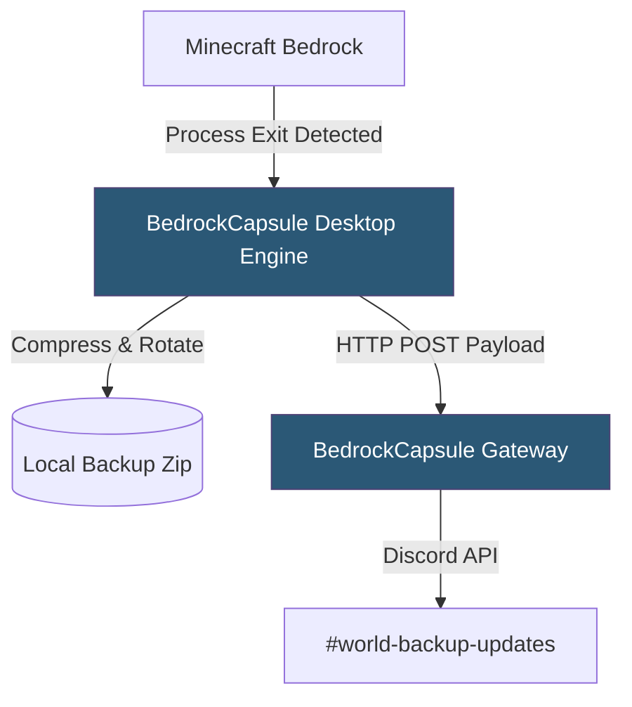

<div align="center">
  
  <h1>📦 BedrockCapsule</h1>
  <p><strong>Automated, lightweight world backup & rollback utility for Minecraft Bedrock on Windows.</strong></p>
  
  <p>
    <a href="https://github.com/NIVYT/BedrockCapsule/releases"></a>
    <a href="https://discord.com"></a>
    <a href="https://python.org"></a>
  </p>
</div>

---

BedrockCapsule runs silently in the background while you play. When you close Minecraft, it automatically captures and archives a timestamped snapshot of your world, logs your playtime, and notifies your private Discord channel.

## ✨ Features
- 🔄 **Auto-Pilot Backups**: Automatically detects your most recently played world and backs it up the moment you exit the game.
- 🕒 **Time Machine UI**: View, manage, and instantly restore past versions of your worlds through a sleek desktop interface.
- 💾 **Smart Storage**: Prevents clutter by limiting maximum backups per world (default: 5) and overwriting the oldest snapshots.
- 📊 **Session Analytics**: Tracks exactly how long you spent in your world during your play session.
- 🤖 **Discord Integration**: Delivers clean, real-time backup confirmation cards to your Discord server via the secure BedrockCapsule gateway.
- 📊 **Session Analytics**: Tracks session history, playtime duration, and total archived states.
- 🛡️ **Zero Overhead**: Uses native Windows APIs and `psutil` process scanning for minimal CPU & RAM usage.

## 🏗️ Architecture



## 🚀 Getting Started

### Prerequisites
- **OS:** Windows 10 or 11
- **Game:** Minecraft Bedrock Edition (Standard or Preview)
- **Environment:** Python 3.10+ (If running from source)

### 🛠️ Running from Source
1. Clone the repository and navigate to the folder.
2. Install dependencies:
   ```bash
   pip install -r requirements.txt
   ```
3. Run the engine:
   ```bash
   python main.py
   ```

### 📦 Building the Executable & Installer
Use the provided batch script to build a standalone `.exe` and a Windows Installer using PyInstaller and Inno Setup.
```cmd
.\build.bat
```
- **Executable output:** `dist/BedrockCapsule_2.1.exe`
- **Installer output:** `Output/BedrockCapsule_Setup_v2.1.exe`

## 👨‍💻 Developer & Credits
Created by **NIVYT** • Built for the Minecraft Bedrock community.
