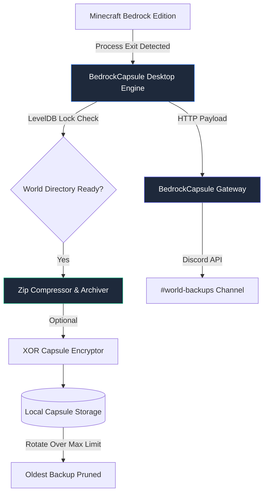

<div align="center">
  
  <h1>BedrockCapsule v2.2</h1>
  <p><strong>Automated, lightweight world backup, encryption & rollback utility for Minecraft Bedrock on Windows.</strong></p>
  
  <p>
    <a href="RELEASE_NOTES.md"></a>
    <a href="https://github.com/NIVYT/BedrockCapsule/releases"></a>
    <a href="https://discord.com"></a>
    <a href="https://python.org"></a>
    <a href="LICENSE"></a>
  </p>
</div>

---

## Overview

**BedrockCapsule** is a companion desktop utility for Minecraft Bedrock Edition players on Windows. It silently monitors your play sessions in the background, automatically capturing timestamped backups the moment you close the game. Whether you encounter world corruption, accidental explosions, or want to branch your survival world, BedrockCapsule gives you instant rollback capability.

> [!NOTE]
> ### Rebranding Announcement
> **BedrockCapsule** was originally developed and released under the name **NIVYT Backup Copilot**. 
> As the project matured from a personal script into a full-featured, open-source desktop ecosystem with automated LevelDB protection, capsule encryption, `.mcworld` exporting, and Discord integration, it was rebranded to **BedrockCapsule** to better reflect its identity as a dedicated capsule backup system for the entire Minecraft Bedrock community.

---

## Features

- **Auto-Pilot Backups**: Automatically identifies your active world by checking `levelname.txt` and timestamp updates, taking a clean snapshot when Minecraft closes.
- **One-Click Rollback & Restore**: Restore any archived snapshot directly into your Minecraft worlds directory with built-in safety rollback in case of decompression errors.
- **Export to `.mcworld`**: Export any snapshot directly to a universal `.mcworld` file for sharing with friends or importing into other devices.
- **Capsule Encryption**: Optional custom XOR encryption passkey to protect your world files and sensitive maps from unauthorized access.
- **Dark & Light Mode UI**: Beautiful, frameless desktop interface with glassmorphic elements, dynamic status badges, and smooth theme switching.
- **Discord Webhook Gateway**: Sends rich embed status cards to your Discord channel showing world name, backup size, trigger type, and timestamp.
- **Smart Storage Rotation**: Configurable snapshot retention limit per world (default: 5) to save disk space while keeping critical checkpoints.
- **System Tray Daemon**: Sits quietly in the Windows system tray with quick-action shortcuts for manual backups and instant directory access.
- **Zero Game Lag**: Uses minimal memory and non-intrusive `psutil` process polling with zero game overhead.

---

## Architecture



---

## Project Structure

```
BedrockCapsule/
├── main.py                  # Core desktop engine & PyWebView bridge
├── index.html               # Modern reactive dashboard UI
├── logo.ico                 # Application icon & branding
├── requirements.txt         # Root Python dependencies
├── build.bat                # Automated one-click build script
├── setup.iss                # Inno Setup wizard compiler script
├── BedrockCapsule_2.2.spec  # PyInstaller packaging configuration
└── README.md                # Documentation & guides
```

---

## Getting Started

### Prerequisites
- **Operating System:** Windows 10 or 11 (64-bit)
- **Minecraft:** Minecraft Bedrock Edition (UWP Standard or Preview)
- **Python:** Python 3.10+ *(Only required if running from source)*
- **Microsoft Edge WebView2 Runtime** *(Pre-installed on modern Windows 10/11)*

---

### Option 1: Installer (Recommended for Users)
1. Download `BedrockCapsule_Setup_v2.2.exe` from the [Releases](https://github.com/NIVYT/BedrockCapsule/releases) page.
2. Run the installer and follow the setup wizard.
3. Check **"Launch on Windows startup"** if you want automated silent backups in the background.

---

### Option 2: Running from Source
1. Clone this repository:
   ```bash
   git clone https://github.com/NIVYT/BedrockCapsule.git
   cd BedrockCapsule
   ```
2. Install the required Python dependencies:
   ```bash
   pip install -r requirements.txt
   ```
3. Run the desktop application:
   ```bash
   python main.py
   ```

---

### Building the Standalone Executable
To compile your own `.exe`:
1. Run the automated build script:
   ```cmd
   .\build.bat
   ```
2. The compiled binary will be output to:
   - **Standalone Executable:** `dist/BedrockCapsule_2.2.exe`
   - **Setup Installer:** `Output/BedrockCapsule_Setup_v2.2.exe`

---

## Configuration & Customization

All application settings are stored locally in:
```
%APPDATA%\BedrockCapsule\config.json
```

| Setting | Default | Description |
| :--- | :--- | :--- |
| `max_backups` | `5` | Maximum number of snapshots preserved per world before auto-pruning. |
| `theme` | `"dark"` | UI theme preference (`"dark"` or `"light"`). |
| `encryption_key` | `""` | Optional passkey for XOR capsule encryption. |
| `custom_world_dir` | `""` | Custom world folder path (if not using default UWP Minecraft directory). |

---

## Contributing

Contributions, issues, and feature requests are welcome!
Feel free to check the [issues page](https://github.com/NIVYT/BedrockCapsule/issues) if you want to contribute.

1. Fork the Project
2. Create your Feature Branch (`git checkout -b feature/AmazingFeature`)
3. Commit your Changes (`git commit -m 'Add some AmazingFeature'`)
4. Push to the Branch (`git push origin feature/AmazingFeature`)
5. Open a Pull Request

---

## License

Distributed under the **MIT License**. See `LICENSE` for more information.

---

<div align="center">
  <p>Crafted by <strong>NIVYT</strong> for the Minecraft Bedrock Community.</p>
</div>
